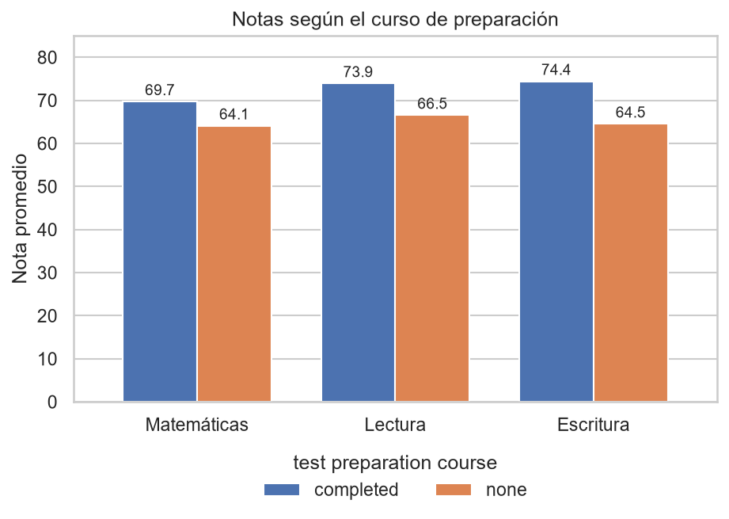
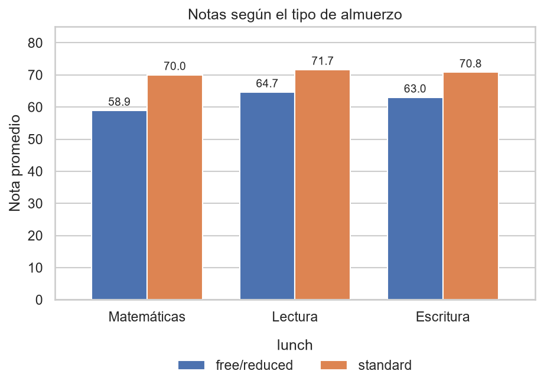
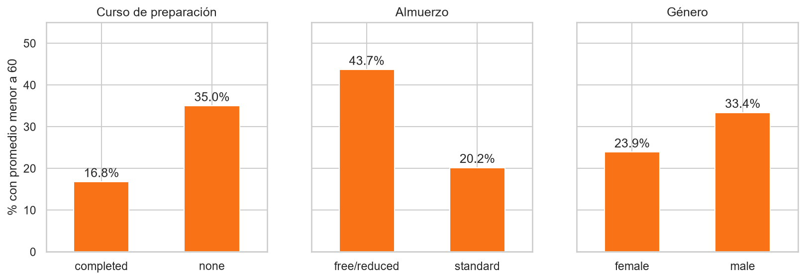
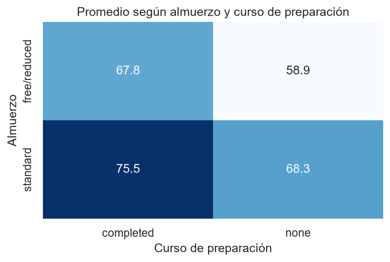
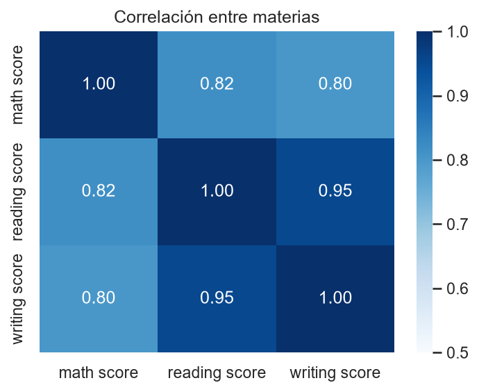

# Rendimiento estudiantil en exámenes: análisis exploratorio con pandas

Análisis exploratorio de las notas de 1,000 estudiantes en matemáticas, lectura y escritura, y de los factores que se asocian con ellas: curso de preparación, tipo de almuerzo, educación de los padres, género y grupo.



## Objetivo

Practicar y demostrar un flujo de análisis de datos con Python: revisar la calidad de los datos, crear variables nuevas, comparar grupos con medidas de resumen, tamaño del efecto y pruebas estadísticas, y comunicar los resultados con gráficos y conclusiones prudentes.

## Herramientas

- **Python 3**
- **pandas y NumPy:** preparación y agregación de datos
- **matplotlib y seaborn:** visualización
- **SciPy:** pruebas estadísticas (t de Welch)
- **Jupyter Notebook** en Visual Studio Code

## Los datos

- **Dataset:** *Student Performance in Exams*, 1,000 filas y 8 columnas: género, grupo, nivel educativo de los padres, tipo de almuerzo, curso de preparación y las notas de matemáticas, lectura y escritura.
- **Fuente:** **[COMPLETAR: enlace de donde lo descargaste]**.
- **Calidad:** sin valores nulos ni filas duplicadas.
- **Aviso:** este dataset educativo suele describirse como **ficticio**. Los resultados sirven para practicar, no para sacar conclusiones sobre estudiantes reales.

## Preguntas y hallazgos

| Pregunta | Hallazgo |
|---|---|
| ¿Se asocia el curso de preparación con mejores notas? | Quienes lo completaron promedian 72.7 y quienes no, 65.0 (+7.6, efecto moderado). La diferencia es mayor en escritura (+9.9) y menor en matemáticas (+5.6). |
| ¿Qué diferencia hay según el tipo de almuerzo? | Almuerzo estándar 70.8 frente a gratuito o reducido 62.2 (+8.6). Es la mayor brecha y se concentra en matemáticas (+11.1). |
| ¿Cómo influye la educación de los padres? | El promedio sube de 63.1 (secundaria completa) a 73.6 (maestría), aunque no de forma estrictamente creciente: "some high school" (65.1) supera a "high school" (63.1). |
| ¿Hay diferencias por género? | Las mujeres puntúan más en lectura (+7.1) y escritura (+9.2); los hombres, en matemáticas (+5.1). En el promedio, las mujeres superan a los hombres por 3.7 puntos (efecto pequeño). |
| ¿Y por grupo? | Los promedios van de 63.0 (grupo A) a 72.8 (grupo E), con grupos de entre 89 y 319 estudiantes. |
| ¿Se combinan los factores? | Sí. Con almuerzo gratuito y sin curso, el promedio es 58.9; con almuerzo estándar y con curso, 75.5. Quienes tienen almuerzo gratuito y completaron el curso (67.8) quedan casi al nivel de quienes tienen almuerzo estándar y no lo hicieron (68.3). |
| ¿Qué proporción tiene un promedio menor a 60? | 35.0% sin curso y 16.8% con curso; 43.7% con almuerzo gratuito y 20.2% con estándar; 33.4% en hombres y 23.9% en mujeres. |
| ¿Cómo se relacionan las materias? | Lectura y escritura casi van juntas (correlación 0.95); matemáticas se relaciona con ambas entre 0.80 y 0.82. |
| ¿Hay valores atípicos? | Entre 5 y 8 por materia, todos en el extremo bajo. Un estudiante tiene 0 en matemáticas. Se conservaron, al no poder confirmar si son errores. |
| ¿Cómo es el 10% con mejores notas frente al 10% con peores? | Entre los mejores, el 56.9% hizo el curso, el 87.3% tiene almuerzo estándar y el 34.3% tiene padres con licenciatura o más. Entre los peores, 18.0%, 40.0% y 9.0%. |

Todas las diferencias entre grupos de curso, almuerzo y género tienen un p-valor menor a 0.001 en la prueba t de Welch. El tamaño del efecto (d de Cohen) va de pequeño (0.26 en género) a moderado (0.63 en almuerzo).

### Algunos gráficos

| | |
|---|---|
|  |  |
|  |  |

## Precauciones al interpretar

- Los resultados son **asociaciones, no causas**: los datos no permiten afirmar que el curso o el almuerzo provoquen las diferencias.
- El tipo de almuerzo es un **indicador indirecto** del nivel socioeconómico.
- El **género y el grupo** son variables sensibles. Se describen sin generalizar, y los grupos A a E no tienen un significado conocido.
- Las categorías A-F usan una **escala supuesta**, no la de una institución real.

## Cómo ejecutarlo

1. Clona o descarga el repositorio y ábrelo como carpeta en **Visual Studio Code** (con las extensiones de Python y Jupyter).
2. Instala las dependencias:
   ```bash
   pip install -r requirements.txt
   ```
3. Abre `notebooks/analisis_rendimiento_estudiantil.ipynb`, elige el kernel de Python arriba a la derecha (*Select Kernel*) y pulsa **Run All**.

El notebook lee los datos con la ruta relativa `../data/StudentsPerformance.csv` y guarda los gráficos en `images/`.

## Estructura del repositorio

```
├── README.md
├── requirements.txt
├── data/
│   └── StudentsPerformance.csv
├── notebooks/
│   └── analisis_rendimiento_estudiantil.ipynb
└── images/
    └── (gráficos generados por el notebook)
```

## Autor

**[Tu nombre]** · [LinkedIn](https://www.linkedin.com/) · [Correo]
